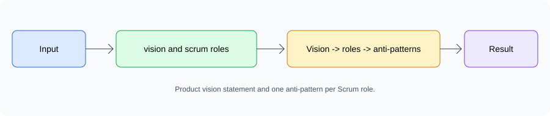

# Question 1 – Vision and scrum roles

**Question:** Write a product vision statement and identify the three Scrum roles for the team, listing one anti-pattern for each role.

**Product vision (FreshCart)**

> **For** busy families in Tamil Nadu and Karnataka **who** want fresh groceries without visiting a store,
> **FreshCart** is a mobile ordering and home-delivery app **that** lets them order from their nearest branch and receive
> the order in a chosen 2-hour slot. **Unlike** national marketplaces, FreshCart shows our stores' live stock and uses our
> own delivery staff, so what you see is what arrives.

Success in the first 6 months: 20,000 monthly active customers, 95% of orders delivered inside the chosen slot, fewer
than 2% of orders with missing items.

**Scrum roles and one anti-pattern each**

| Role | Who | Responsibility | Anti-pattern to avoid |
|---|---|---|---|
| Product Owner | Ramesh (Head of E-commerce) | Owns the vision, orders the backlog, accepts stories, talks to store managers and marketing. | Proxy PO – the PO cannot decide and sends every question to a steering committee, so the team waits days for answers. |
| Scrum Master | Anitha | Coaches the team on Scrum, facilitates events, removes impediments (e.g. getting payment-gateway sandbox access). | Acting as a project manager – assigning tasks to developers and asking for daily status reports. |
| Developers | 5 people: 2 mobile, 2 backend, 1 tester | Build, test and deliver a usable increment every sprint; own the sprint backlog and estimates. | Mini-waterfall inside the sprint – coding finishes on day 9 and testing is pushed to the next sprint, so nothing is really 'Done'. |

## Files in this folder

- [flowchart.svg](flowchart.svg)

## Approach

