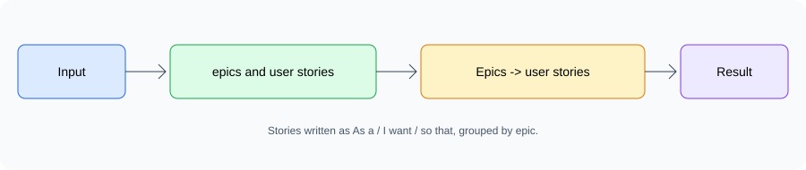

# Question 2 – Epics and user stories

**Question:** Create at least three epics (for example Browse and Search, Cart and Checkout, Delivery Tracking) and break them into 12 user stories in the 'As a / I want / so that' format.

3 epics, 13 user stories.

### E1 – Browse and Search

| ID | User story |
|---|---|
| S1 | As a customer, I want to browse products by category and sub-category, so that I can find what I need without typing. |
| S2 | As a customer, I want to search products by name and get results even with small spelling mistakes, so that I find items quickly. |
| S3 | As a customer, I want to filter results by price, brand and veg / non-veg, so that I narrow a long list to what suits me. |
| S4 | As a customer, I want to see whether an item is in stock at my nearest store, so that I don't order something that cannot be delivered. |

### E2 – Cart and Checkout

| ID | User story |
|---|---|
| S5 | As a customer, I want to add items to my cart and change quantities, so that I can build my order. |
| S6 | As a customer, I want to apply a coupon code to my cart, so that I get the advertised discount. |
| S7 | As a customer, I want to choose a 2-hour delivery slot, so that someone is home when the order arrives. |
| S8 | As a customer, I want to pay by UPI, card or cash on delivery, so that I can pay the way I prefer. |
| S9 | As a returning customer, I want to reorder a previous order in one tap, so that my weekly shopping takes a minute. |

### E3 – Delivery Tracking

| ID | User story |
|---|---|
| S10 | As a customer, I want to see my order status (packed, out for delivery, delivered), so that I know when to expect it. |
| S11 | As a customer, I want to get a notification when my order is out for delivery, so that I can be ready at the door. |
| S12 | As a customer, I want to report a missing or damaged item after delivery, so that I get a refund without calling the store. |
| S13 | As a customer, I want to track the delivery partner live on a map, so that I know exactly how far away they are. |

## Files in this folder

- [flowchart.svg](flowchart.svg)

## Approach

