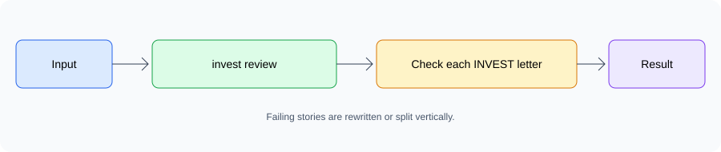

# Question 3 – Invest review

**Question:** Apply the INVEST checklist to every story and rewrite at least two stories that fail it.

**INVEST** = Independent, Negotiable, Valuable, Estimable, Small, Testable.

### Stories that failed INVEST in the first draft and how they were rewritten

**Original:** As a customer I want the whole checkout to work so that I can buy groceries.

- Problem: Fails **Small** and **Estimable** – covers cart, slot, payment and confirmation; nobody can size it.
- Fix: Split into S5 (cart), S7 (delivery slot) and S8 (payment), each deliverable on its own.

**Original:** As a developer I want a products table in the database so that we can store products.

- Problem: Fails **Valuable** – no user benefit on its own; it is a technical task.
- Fix: Rewritten as S1 'browse products by category'; the table becomes a task inside S1.

**Original:** As a customer I want the app to be fast.

- Problem: Fails **Testable** – 'fast' cannot be checked.
- Fix: Rewritten as an acceptance criterion on S2: search results appear within 2 seconds on 4G for 95% of searches.

### Checklist for the final stories

| Story | I | N | V | E | S | T | Result |
|---|---|---|---|---|---|---|---|
| S1 | ✔ | ✔ | ✔ | ✔ | ✔ | ✔ | Passes |
| S2 | ✔ | ✔ | ✔ | ✔ | ✔ | ✔ | Passes |
| S3 | ✔ | ✔ | ✔ | ✔ | ✔ | ✔ | Passes |
| S4 | ✔ | ✔ | ✔ | ✔ | ✔ | ✔ | Passes |
| S5 | ✔ | ✔ | ✔ | ✔ | ✔ | ✔ | Passes |
| S6 | ✔ | ✔ | ✔ | ✔ | ✔ | ✔ | Passes |
| S7 | ✔ | ✔ | ✔ | ✔ | ✔ | ✔ | Passes |
| S8 | ✔ | ✔ | ✔ | ✔ | ✔ | ✔ | Passes |
| S9 | ✔ | ✔ | ✔ | ✔ | ✔ | ✔ | Passes |
| S10 | ✔ | ✔ | ✔ | ✔ | ✔ | ✔ | Passes |
| S11 | ✔ | ✔ | ✔ | ✔ | ✔ | ✔ | Passes |
| S12 | ✔ | ✔ | ✔ | ✔ | ✔ | ✔ | Passes |
| S13 | ✔ | ✔ | ✔ | ✔ | ⚠ | ✔ | S fails (13 pts) – kept as Won't for now and must be split before it can enter a sprint |

## Files in this folder

- [flowchart.svg](flowchart.svg)

## Approach

