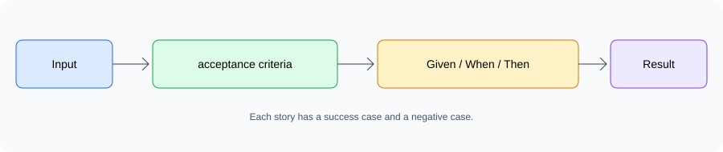

# Question 4 – Acceptance criteria

**Question:** Write Given / When / Then acceptance criteria for five stories, including one negative scenario.

### S5 – Add items to cart

_As a customer, I want to add items to my cart and change quantities, so that I can build my order._

**Scenario: Add an item**

```gherkin
Given I am on the product page of 'Basmati Rice 5kg' which is in stock
When I tap 'Add to cart'
Then the cart badge shows 1 and the cart total increases by Rs.645
```

**Scenario: Change quantity**

```gherkin
Given my cart has 1 'Basmati Rice 5kg'
When I change the quantity to 3
Then the line total becomes Rs.1,935 and the cart total is updated
```

### S6 – Apply coupon

_As a customer, I want to apply a coupon code to my cart, so that I get the advertised discount._

**Scenario: Valid coupon**

```gherkin
Given my cart total is Rs.1,200 and coupon FRESH100 needs a minimum of Rs.999
When I apply FRESH100
Then Rs.100 is deducted and the coupon is shown on the bill
```

**Scenario: Negative – expired coupon**

```gherkin
Given coupon DIWALI50 expired on 31 Oct 2026
When I apply DIWALI50
Then I see 'This coupon has expired' and the cart total does not change
```

### S7 – Choose delivery slot

_As a customer, I want to choose a 2-hour delivery slot, so that someone is home when the order arrives._

**Scenario: Slot available**

```gherkin
Given slots for today 6–8 PM have capacity
When I choose 6–8 PM
Then the slot is reserved for 10 minutes while I pay
```

**Scenario: Negative – slot full**

```gherkin
Given the 6–8 PM slot has no capacity left
When I open the slot list
Then 6–8 PM is greyed out with 'Full' and cannot be selected
```

### S8 – Pay by UPI

_As a customer, I want to pay by UPI, card or cash on delivery, so that I can pay the way I prefer._

**Scenario: UPI success**

```gherkin
Given I have chosen UPI and my UPI app approves the payment
When the payment gateway confirms success
Then the order is placed and I see the order number
```

**Scenario: Negative – UPI declined**

```gherkin
Given my UPI payment is declined
When the gateway returns a failure
Then the order is not placed, the cart is kept and I can retry or choose another method
```

### S10 – Order status

_As a customer, I want to see my order status (packed, out for delivery, delivered), so that I know when to expect it._

**Scenario: Status update**

```gherkin
Given my order is packed at the store
When the delivery partner picks it up
Then my order status changes to 'Out for delivery' within 1 minute
```


## Files in this folder

- [flowchart.svg](flowchart.svg)

## Approach


