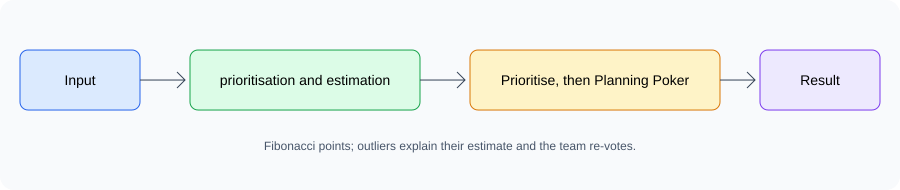

# Question 5 – Prioritisation and estimation

**Question:** Prioritise the backlog using MoSCoW, estimate the stories with Fibonacci story points using Planning Poker, and justify the reference story chosen.

### Prioritised backlog (MoSCoW)

| Story | Epic | MoSCoW | Points |
|---|---|---|---|
| S8 to pay by UPI, card or cash on delivery | Cart and Checkout | Must | 8 |
| S2 to search products by name and get results even with small spelling mistakes | Browse and Search | Must | 5 |
| S4 to see whether an item is in stock at my nearest store | Browse and Search | Must | 5 |
| S7 to choose a 2-hour delivery slot | Cart and Checkout | Must | 5 |
| S1 to browse products by category and sub-category | Browse and Search | Must | 3 |
| S5 to add items to my cart and change quantities | Cart and Checkout | Must | 3 |
| S10 to see my order status (packed, out for delivery, delivered) | Delivery Tracking | Must | 3 |
| S12 to report a missing or damaged item after delivery | Delivery Tracking | Should | 5 |
| S3 to filter results by price, brand and veg / non-veg | Browse and Search | Should | 3 |
| S6 to apply a coupon code to my cart | Cart and Checkout | Should | 3 |
| S11 to get a notification when my order is out for delivery | Delivery Tracking | Should | 2 |
| S9 to reorder a previous order in one tap | Cart and Checkout | Could | 2 |
| S13 to track the delivery partner live on a map | Delivery Tracking | Won't (this release) | 13 |

**Total backlog size: 60 story points** (13 stories)

Points by MoSCoW: Must 32, Should 13, Could 2, Won't (this release) 13. The Must stories (32 points) form the first release.

### Reference story

**S5 – Add items to cart = 3 points.** Everyone understands it, it touches all layers (app screen, API, database) without unknowns, and the team has built a similar cart before. Each other story was compared with it: 'is this about the same, half, or double the effort of the cart story?'

### Planning Poker (Fibonacci cards 1, 2, 3, 5, 8, 13; each developer shows a card at the same time)

**S2 – Search with spelling mistakes**

- Round 1: 3, 5, 5, 13, 5
- Round 2: 5, 5, 5, 8, 5

The 13 came from the backend developer who thought we had to build fuzzy search ourselves. The team agreed to use the search engine's built-in fuzzy matching, and settled on 5.

**S8 – Pay by UPI, card or COD**

- Round 1: 5, 8, 8, 13, 8
- Round 2: 8, 8, 8, 8, 8

The 5 assumed only UPI; once the tester reminded the team about card and COD flows plus failure handling, all agreed on 8.

**S9 – Reorder**

- Round 1: 2, 2, 3, 2, 2

Agreed on 2 after a short chat – it reuses the cart.

## Files in this folder

- [backlog_table.csv](backlog_table.csv)
- [flowchart.svg](flowchart.svg)

## Approach

