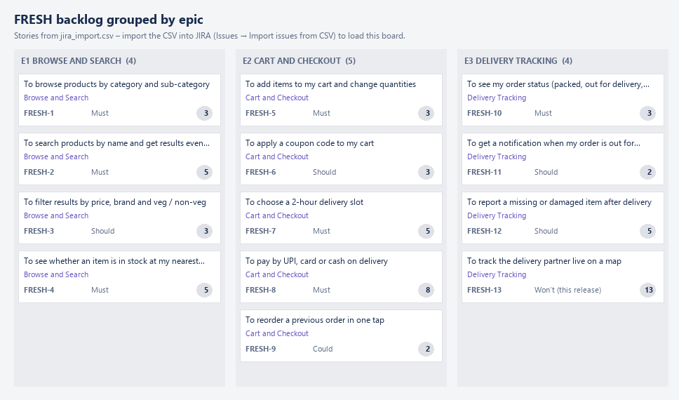
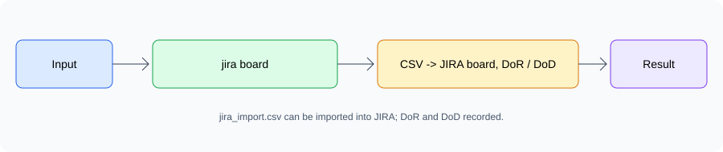

# Question 6 – Jira board

**Question:** Publish the epics and stories on a JIRA board with the Definition of Ready and Definition of Done recorded.

JIRA project key **FRESH**: 3 epics and 13 stories (60 points).

**How to load it into JIRA:** create a Scrum project with key FRESH, then *Settings → System → External System Import → CSV*, choose `output/jira_import.csv` and map the columns (Issue Id, Issue Type, Summary, Description, Parent Id, Priority, Story Points, Status).

_Board layout of the stories in `jira_import.csv` – importing the CSV into JIRA loads the same board._

## Definition of Ready

- [ ] Story written as 'As a / I want / so that'
- [ ] Acceptance criteria written in Given / When / Then
- [ ] Estimated by the team in story points
- [ ] Dependencies (e.g. payment gateway, SMS provider) identified
- [ ] UI mock-up attached where a screen changes
- [ ] Small enough to finish in one sprint (8 points or less)
- [ ] Product Owner has prioritised it

## Definition of Done

- [ ] Code reviewed and merged to main through a pull request
- [ ] Unit tests written and passing (coverage of new code ≥ 80%)
- [ ] All acceptance criteria tested and passed on the test environment
- [ ] No open critical or high bugs
- [ ] Works on Android 10+ and iOS 15+
- [ ] Product Owner has accepted the story in the review
- [ ] User-facing text and release notes updated

## Files in this folder

- [flowchart.svg](flowchart.svg)
- [jira_board.png](jira_board.png)
- [jira_import.csv](jira_import.csv)

## Approach

