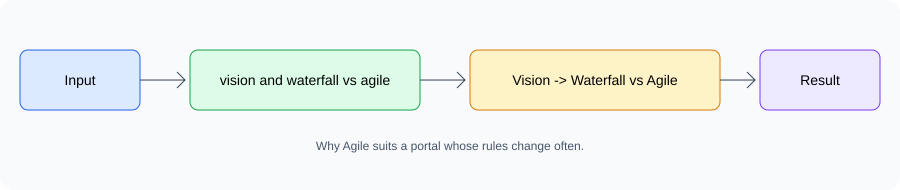

# Question 1 – Vision and waterfall vs agile

**Question:** Draft the product vision and a Waterfall-versus-Agile comparison (maximum half a page) explaining why Agile suits this programme.

**Product vision (ClaimEasy portal)**

> **For** our health, motor and home policy holders **who** need to make a claim quickly and without paperwork,
> **ClaimEasy** is a self-service web and mobile portal **that** lets them register a claim, upload documents and follow
> the settlement online. **Unlike** today's call-centre and branch process, customers always know the claim status and
> the next step.

Goals for the first year: 60% of new claims registered online, average time to settle a simple claim down from 21 to 10
days, 30% fewer "where is my claim?" calls.

**Waterfall vs Agile for this programme**

| | Waterfall | Agile (Scrum) |
|---|---|---|
| Requirements | Fixed up front for all claim types | Refined every sprint from customer and IRDAI feedback |
| First release | After all phases (~12 months) | Motor claim registration live after ~3 sprints |
| Change | Expensive change requests | New regulator rules or partner hospital needs go into the backlog |
| Risk | Integration and usability problems found at the end | Each sprint shows a working increment to real users |
| Customer involvement | At sign-off and UAT | Every sprint review |

Agile suits ClaimEasy because claim rules change often, users' behaviour with document upload is unknown, and the business
gains value from releasing one claim type at a time instead of waiting for all of them.

## Files in this folder

- [flowchart.svg](flowchart.svg)

## Approach

