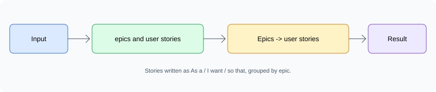

# Question 2 – Epics and user stories

**Question:** Define four epics (Claim Registration, Document Upload, Claim Tracking, Settlement Notifications) and split them into 12–14 user stories.

4 epics, 14 user stories.

### E1 – Claim Registration

| ID | User story |
|---|---|
| S1 | As a policy holder, I want to log in with my policy number and an OTP, so that only I can raise claims on my policy. |
| S2 | As a policy holder, I want to register a motor claim with incident date, place and description, so that my claim is started without visiting a branch. |
| S3 | As a policy holder, I want to register a health claim for a hospital stay, so that I can claim reimbursement online. |
| S4 | As a policy holder, I want to save a half-filled claim as a draft, so that I can finish it later. |
| S14 | As a branch agent, I want to register a claim on behalf of a walk-in customer, so that customers without smartphones are also served. |

### E2 – Document Upload

| ID | User story |
|---|---|
| S5 | As a policy holder, I want to upload photos and PDFs of my documents from my phone, so that I don't have to courier papers. |
| S6 | As a policy holder, I want to see a checklist of documents still needed for my claim, so that I submit everything in one go. |
| S7 | As a claims officer, I want to see uploaded documents next to the claim, so that I can assess without asking for files by email. |

### E3 – Claim Tracking

| ID | User story |
|---|---|
| S8 | As a policy holder, I want to see the current status and next step of my claim, so that I don't need to call the helpline. |
| S9 | As a policy holder, I want to see the history of status changes with dates, so that I know how long each step took. |
| S10 | As a policy holder, I want to message the claims officer from the claim page, so that my questions are kept with the claim. |

### E4 – Settlement Notifications

| ID | User story |
|---|---|
| S11 | As a policy holder, I want to get an SMS and email when my claim is approved or rejected, so that I know the decision immediately. |
| S12 | As a policy holder, I want to see the settled amount and any deductions explained, so that I understand what I was paid. |
| S13 | As a policy holder, I want to download the settlement letter as PDF, so that I have proof for my records. |

## Files in this folder

- [flowchart.svg](flowchart.svg)

## Approach

