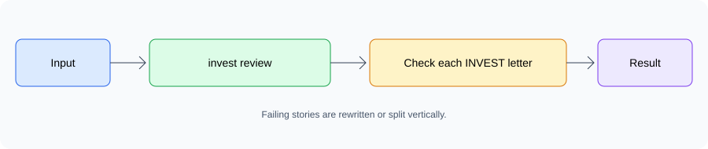

# Question 3 – Invest review

**Question:** Run an INVEST review; identify stories that are too large and split them vertically rather than by technical layer.

**INVEST** = Independent, Negotiable, Valuable, Estimable, Small, Testable.

### Stories that failed INVEST in the first draft and how they were rewritten

**Original:** As a policy holder I want to register any type of claim (motor, health, home, travel) with all documents.

- Problem: Too big – fails **Small** and **Estimable** (estimated at 40+ points).
- Fix: Split **vertically by claim type**: S2 motor registration and S3 health registration, each going from screen to database and usable on its own. Home and travel stay in the backlog for later sprints.

**Original:** As a policy holder I want document upload (front-end), then API, then storage.

- Problem: A **horizontal** split by technical layer – no single part gives value or can be demonstrated alone.
- Fix: Replaced by S5 'upload photos and PDFs from my phone' (all layers for one file type), then S6 'checklist of documents still needed' – each is a thin, end-to-end slice.

**Original:** As a policy holder I want to track my claim, chat with the officer and get notified.

- Problem: Too big and mixes three epics – fails **Independent** and **Small**.
- Fix: Split into S8 (status), S10 (messaging) and S11 (notifications).

### Checklist for the final stories

| Story | I | N | V | E | S | T | Result |
|---|---|---|---|---|---|---|---|
| S1 | ✔ | ✔ | ✔ | ✔ | ✔ | ✔ | Passes |
| S2 | ✔ | ✔ | ✔ | ✔ | ✔ | ✔ | Passes |
| S3 | ✔ | ✔ | ✔ | ✔ | ✔ | ✔ | Passes |
| S4 | ✔ | ✔ | ✔ | ✔ | ✔ | ✔ | Passes |
| S5 | ✔ | ✔ | ✔ | ✔ | ✔ | ✔ | Passes |
| S6 | ✔ | ✔ | ✔ | ✔ | ✔ | ✔ | Passes |
| S7 | ✔ | ✔ | ✔ | ✔ | ✔ | ✔ | Passes |
| S8 | ✔ | ✔ | ✔ | ✔ | ✔ | ✔ | Passes |
| S9 | ✔ | ✔ | ✔ | ✔ | ✔ | ✔ | Passes |
| S10 | ✔ | ✔ | ✔ | ✔ | ⚠ | ✔ | S borderline (8 pts) – kept, but the team noted it may split into 'send' and 'reply' if refinement finds more work |
| S11 | ✔ | ✔ | ✔ | ✔ | ✔ | ✔ | Passes |
| S12 | ✔ | ✔ | ✔ | ✔ | ✔ | ✔ | Passes |
| S13 | ✔ | ✔ | ✔ | ✔ | ✔ | ✔ | Passes |
| S14 | ✔ | ✔ | ✔ | ✔ | ✔ | ✔ | Passes |

## Files in this folder

- [flowchart.svg](flowchart.svg)

## Approach

