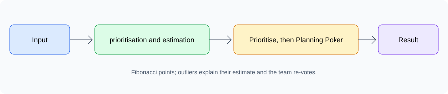

# Question 5 – Prioritisation and estimation

**Question:** Estimate every story using Planning Poker values (1, 2, 3, 5, 8, 13), record the discussion on any outlier and compute the total backlog size.

### Prioritised backlog (Priority (Highest / High / Medium / Low))

| Story | Epic | Priority (Highest / High / Medium / Low) | Points |
|---|---|---|---|
| S2 to register a motor claim with incident date, place and description | Claim Registration | Highest | 5 |
| S5 to upload photos and PDFs of my documents from my phone | Document Upload | Highest | 5 |
| S8 to see the current status and next step of my claim | Claim Tracking | Highest | 3 |
| S3 to register a health claim for a hospital stay | Claim Registration | High | 5 |
| S12 to see the settled amount and any deductions explained | Settlement Notifications | High | 5 |
| S1 to log in with my policy number and an OTP | Claim Registration | High | 3 |
| S6 to see a checklist of documents still needed for my claim | Document Upload | High | 3 |
| S7 to see uploaded documents next to the claim | Document Upload | High | 3 |
| S11 to get an SMS and email when my claim is approved or rejected | Settlement Notifications | High | 3 |
| S4 to save a half-filled claim as a draft | Claim Registration | Medium | 3 |
| S9 to see the history of status changes with dates | Claim Tracking | Medium | 2 |
| S13 to download the settlement letter as PDF | Settlement Notifications | Medium | 2 |
| S10 to message the claims officer from the claim page | Claim Tracking | Low | 8 |
| S14 to register a claim on behalf of a walk-in customer | Claim Registration | Low | 5 |

**Total backlog size: 55 story points** (14 stories)

### Planning Poker (Fibonacci cards 1, 2, 3, 5, 8, 13; each developer shows a card at the same time)

**S10 – Message the claims officer**

- Round 1: 3, 5, 13, 5, 8, 5
- Round 2: 8, 8, 8, 5, 8, 8

Outlier 13 (backend): messages need to be stored, audited for the regulator and routed to the right officer. Outlier 3 (front-end) only thought of the chat box. After discussing, the team agreed on 8 with audit logging included.

**S12 – Settled amount explained**

- Round 1: 5, 5, 2, 5, 5, 5

The 2 assumed the amount is a single field; the analyst explained deductions (deductible, depreciation, non-payables) must be listed. Agreed 5.

**S9 – Status history**

- Round 1: 2, 2, 2, 2, 3, 2

Agreed 2 immediately.

## Files in this folder

- [backlog_table.csv](backlog_table.csv)
- [flowchart.svg](flowchart.svg)

## Approach

