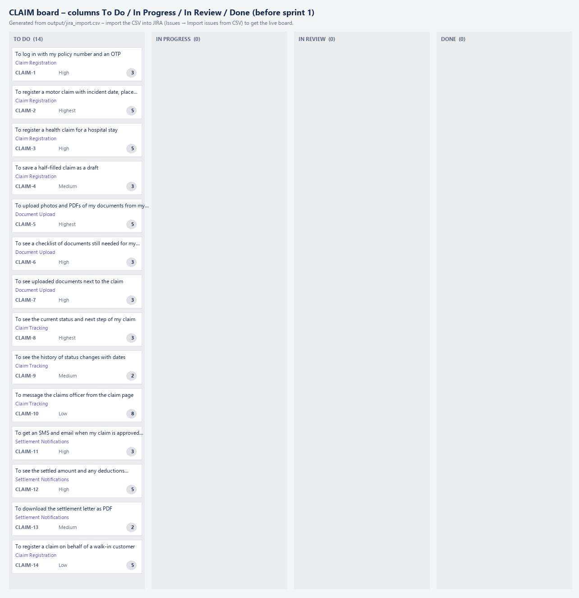

# Jira board

**Question:** Create the JIRA project with the board, epics, story states (To Do, In Progress, In Review, Done) and attach the DoD.

JIRA project key **CLAIM**: 4 epics and 14 stories (55 points).

Board columns / workflow states: **To Do → In Progress → In Review → Done**. The DoD below is attached to the board (JIRA: Board settings → add it to the board description / a pinned Confluence page).

**How to load it into JIRA:** create a Scrum project with key CLAIM, then *Settings → System → External System Import → CSV*, choose `output/jira_import.csv` and map the columns (Issue Id, Issue Type, Summary, Description, Parent Id, Priority, Story Points, Status).

_The picture is generated from the CSV to show the board layout; it is not a screenshot from JIRA._

## Definition of Done

- [ ] Code peer-reviewed and merged to main
- [ ] Unit and API tests pass in the CI pipeline
- [ ] Acceptance criteria verified by the tester on the staging portal
- [ ] Accessibility check (WCAG 2.1 AA) on new screens
- [ ] Customer data masked in logs; security scan has no high findings
- [ ] Product Owner accepted the story
- [ ] Help text and release notes updated
