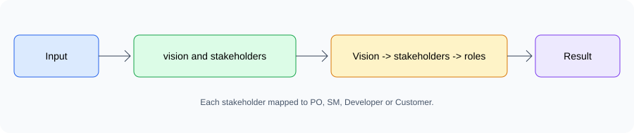

# Question 1 – Vision and stakeholders

**Question:** Write the vision statement and list the stakeholders; map each stakeholder to Product Owner, Scrum Master, Developer or Customer.

**Product vision (CareSlot)**

> **For** patients of our 6 hospitals **who** waste time on phone queues to see a doctor, **CareSlot** is a mobile app
> **that** lets them book, reschedule or cancel an appointment in under a minute and reminds them before the visit.
> **Unlike** the current call centre, patients see real free slots, and doctors see a reliable schedule with fewer no-shows.

Targets: 70% of appointments booked in the app within a year, no-shows down from 18% to under 8%.

**Stakeholders and Scrum mapping**

| Stakeholder | Interest | Scrum mapping |
|---|---|---|
| Head of Outpatient Services (Dr. Kavitha) | Owns patient experience and appointment rules | **Product Owner** |
| Agile coach from the PMO (Mohan) | Runs Scrum, removes blockers | **Scrum Master** |
| 2 mobile developers, 2 backend developers, 1 QA, 1 UX designer | Build the app | **Developers** |
| Patients and their family members | Book and manage appointments | **Customer** (end user) |
| Doctors and consultants | Manage their schedules and leave | **Customer** (end user) |
| Front-desk / reception staff | Handle walk-ins and changes | **Customer** (end user) |
| Hospital IT (HIS integration) | Patient records and doctor master data | Customer / supporting stakeholder – gives requirements to the PO |
| Finance (consultation fees) | Online payment of fees | Customer – input to the PO |
| Compliance / data protection officer | Patient data privacy | Customer – constraints given to the PO |

## Files in this folder

- [flowchart.svg](flowchart.svg)

## Approach

