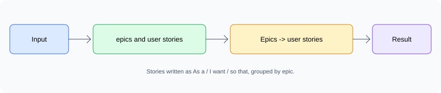

# Question 2 – Epics and user stories

**Question:** Create epics for Booking, Rescheduling and Cancellation, Reminders and Doctor Schedule Management, and write at least 12 user stories.

4 epics, 13 user stories.

### E1 – Booking

| ID | User story |
|---|---|
| S1 | As a patient, I want to search doctors by speciality, hospital and language, so that I find the right doctor. |
| S2 | As a patient, I want to see a doctor's free slots for the next 14 days, so that I can pick a convenient time. |
| S3 | As a patient, I want to book a free slot and get a confirmation number, so that my appointment is guaranteed. |
| S4 | As a patient, I want to pay the consultation fee online while booking, so that I skip the billing queue. |
| S5 | As a patient, I want to book for a family member from my account, so that I can manage my parents' visits. |

### E2 – Rescheduling and Cancellation

| ID | User story |
|---|---|
| S6 | As a patient, I want to reschedule my appointment to another free slot of the same doctor, so that I don't lose my booking when plans change. |
| S7 | As a patient, I want to cancel my appointment up to 2 hours before the slot, so that the slot is freed for someone else. |
| S8 | As a patient, I want to get a refund when I cancel a prepaid appointment, so that I don't lose money. |

### E3 – Reminders

| ID | User story |
|---|---|
| S9 | As a patient, I want an SMS and app reminder 24 hours and 2 hours before my appointment, so that I don't forget the visit. |
| S10 | As a patient, I want to confirm or cancel from the reminder message, so that I can respond in one tap. |

### E4 – Doctor Schedule Management

| ID | User story |
|---|---|
| S11 | As a doctor, I want to see my appointments for the day in order, so that I can plan my clinic. |
| S12 | As a doctor, I want to block slots for leave or surgery, so that patients cannot book when I'm unavailable. |
| S13 | As a receptionist, I want to move all of a doctor's patients to another doctor when the doctor is absent, so that patients are still seen. |

## Files in this folder

- [flowchart.svg](flowchart.svg)

## Approach

