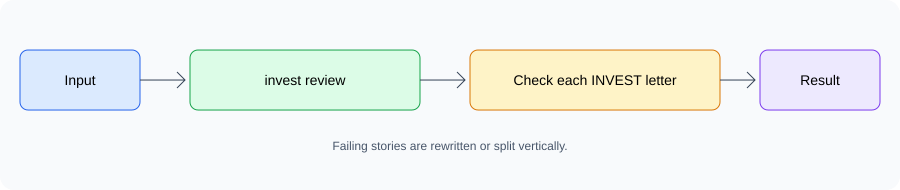

# Question 3 – Invest review

**Question:** Review each story against INVEST and rewrite those that are not independent or testable.

**INVEST** = Independent, Negotiable, Valuable, Estimable, Small, Testable.

### Stories that failed INVEST in the first draft and how they were rewritten

**Original:** As a patient I want to book an appointment after the doctor search and payment screens are done.

- Problem: Not **Independent** – it says it can only be built after two other stories.
- Fix: Rewritten as S3 'book a free slot and get a confirmation number' with no dependency on payment. Payment (S4) is a separate story that adds to booking; booking works with 'pay at hospital' until S4 is done.

**Original:** As a patient I want reminders to be convenient.

- Problem: Not **Testable** – 'convenient' cannot be checked.
- Fix: Rewritten as S9: reminders by SMS and in-app notification exactly 24 hours and 2 hours before the slot.

**Original:** As a patient I want to reschedule or cancel, and get my money back.

- Problem: Not **Independent** / too big – three behaviours with different rules.
- Fix: Split into S6 reschedule, S7 cancel and S8 refund.

### Checklist for the final stories

| Story | I | N | V | E | S | T | Result |
|---|---|---|---|---|---|---|---|
| S1 | ✔ | ✔ | ✔ | ✔ | ✔ | ✔ | Passes |
| S2 | ✔ | ✔ | ✔ | ✔ | ✔ | ✔ | Passes |
| S3 | ✔ | ✔ | ✔ | ✔ | ✔ | ✔ | Passes |
| S4 | ✔ | ✔ | ✔ | ✔ | ✔ | ✔ | Passes |
| S5 | ✔ | ✔ | ✔ | ✔ | ✔ | ✔ | Passes |
| S6 | ✔ | ✔ | ✔ | ✔ | ✔ | ✔ | Passes |
| S7 | ✔ | ✔ | ✔ | ✔ | ✔ | ✔ | Passes |
| S8 | ✔ | ✔ | ✔ | ✔ | ✔ | ✔ | Passes |
| S9 | ✔ | ✔ | ✔ | ✔ | ✔ | ✔ | Passes |
| S10 | ✔ | ✔ | ✔ | ✔ | ✔ | ✔ | Passes |
| S11 | ✔ | ✔ | ✔ | ✔ | ✔ | ✔ | Passes |
| S12 | ✔ | ✔ | ✔ | ✔ | ✔ | ✔ | Passes |
| S13 | ✔ | ✔ | ✔ | ✔ | ⚠ | ✔ | S borderline (8 pts) – acceptable, will be split in refinement if needed |

## Files in this folder

- [flowchart.svg](flowchart.svg)

## Approach

