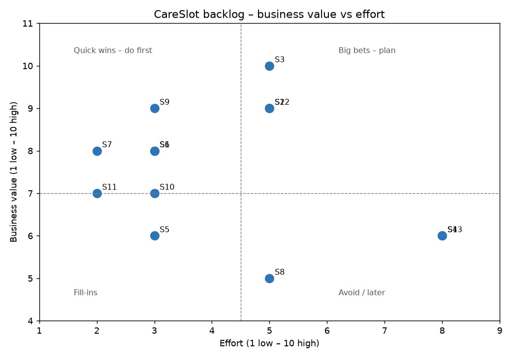

# Prioritisation and estimation

**Question:** Prioritise with business value versus effort, run a Planning Poker round, and explain how a story-point differs from an hour.

### Prioritised backlog (Business value vs effort)

| Rank | Story | Epic | Value | Effort | Value / effort | Points |
|---|---|---|---|---|---|---|
| 1 | S7 to cancel my appointment up to 2 hours before the slot | Rescheduling and Cancellation | 8 | 2 | 4.00 | 2 |
| 2 | S11 to see my appointments for the day in order | Doctor Schedule Management | 7 | 2 | 3.50 | 2 |
| 3 | S9 an SMS and app reminder 24 hours and 2 hours before my appointment | Reminders | 9 | 3 | 3.00 | 3 |
| 4 | S1 to search doctors by speciality, hospital and language | Booking | 8 | 3 | 2.67 | 3 |
| 5 | S6 to reschedule my appointment to another free slot of the same doctor | Rescheduling and Cancellation | 8 | 3 | 2.67 | 3 |
| 6 | S10 to confirm or cancel from the reminder message | Reminders | 7 | 3 | 2.33 | 3 |
| 7 | S3 to book a free slot and get a confirmation number | Booking | 10 | 5 | 2.00 | 5 |
| 8 | S5 to book for a family member from my account | Booking | 6 | 3 | 2.00 | 3 |
| 9 | S2 to see a doctor's free slots for the next 14 days | Booking | 9 | 5 | 1.80 | 5 |
| 10 | S12 to block slots for leave or surgery | Doctor Schedule Management | 9 | 5 | 1.80 | 5 |
| 11 | S8 to get a refund when I cancel a prepaid appointment | Rescheduling and Cancellation | 5 | 5 | 1.00 | 5 |
| 12 | S4 to pay the consultation fee online while booking | Booking | 6 | 8 | 0.75 | 8 |
| 13 | S13 to move all of a doctor's patients to another doctor when the doctor is absent | Doctor Schedule Management | 6 | 8 | 0.75 | 8 |

**Total backlog size: 55 story points** (13 stories)

### Planning Poker (Fibonacci cards 1, 2, 3, 5, 8, 13; each developer shows a card at the same time)

**S12 – Doctor blocks slots**

- Round 1: 3, 5, 5, 8, 5, 5

The 8 was worried about patients who already booked a slot that gets blocked. The PO said those patients are handled by S13 (move patients), so this story only blocks free slots. Agreed 5.

**Story point vs hour**

A story point is a **relative** measure of the size of a story – effort, complexity and uncertainty together – compared
with other stories (S7 cancel = 2, S3 book = 5, so booking is about 2.5 times bigger). It does not depend on who does
the work. An hour is an **absolute** measure of time for one person and changes with that person's skill and
interruptions. Points are used for release and sprint planning through velocity (e.g. 20 points per sprint); hours, if
used at all, are for breaking a story into tasks inside the sprint.
