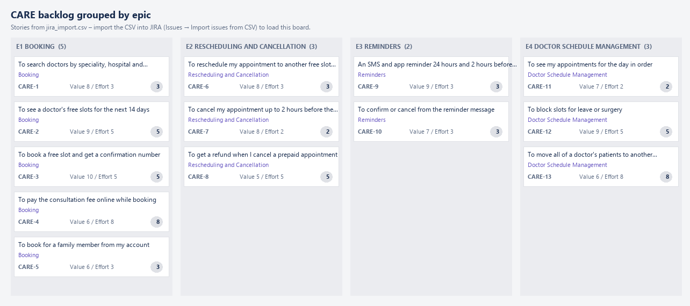
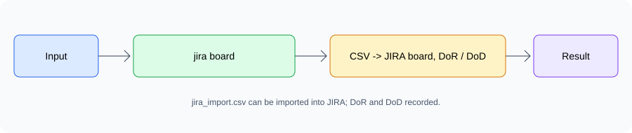

# Question 6 – Jira board

**Question:** Publish the backlog in JIRA and define the team's DoR and DoD with at least six checklist items each.

JIRA project key **CARE**: 4 epics and 13 stories (55 points).

**How to load it into JIRA:** create a Scrum project with key CARE, then *Settings → System → External System Import → CSV*, choose `output/jira_import.csv` and map the columns (Issue Id, Issue Type, Summary, Description, Parent Id, Priority, Story Points, Status).

_Board layout of the stories in `jira_import.csv` – importing the CSV into JIRA loads the same board._

## Definition of Ready

- [ ] Story follows 'As a / I want / so that' and has a clear user
- [ ] Acceptance criteria in Given / When / Then, including error cases
- [ ] Estimated in story points by the whole team
- [ ] Dependencies on HIS, SMS or payment services identified and available
- [ ] UX design for new screens reviewed
- [ ] Fits in one sprint (≤ 8 points)
- [ ] Data privacy impact checked by the PO

## Definition of Done

- [ ] Code reviewed by another developer and merged
- [ ] Unit tests written; all automated tests green in the pipeline
- [ ] Acceptance criteria tested on Android and iOS test devices
- [ ] No critical / high defects open
- [ ] Patient data encrypted in transit and at rest; no personal data in logs
- [ ] Accepted by the Product Owner
- [ ] Deployed to the staging environment

## Files in this folder

- [flowchart.svg](flowchart.svg)
- [jira_board.png](jira_board.png)
- [jira_import.csv](jira_import.csv)

## Approach

